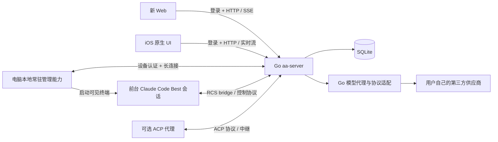

# Claude Code Best、Go 服务端与新 Web / iOS 融合改造方案

> 状态：方案与实施路线，尚未完成代码迁移。整理日期：2026-10-30。依据当前工作区源码静态分析；涉及运行时能力的结论仍需在实际环境中验证。

## 1. 目标与边界

1. **Web**：以 `D:/Develop/PyCharmProject/claude-code/packages/remote-control-server/web/` 为新 Web 源头，替代原有 `web-next` 产品页面。新 Web 需要接入 My Claude 用户、设备、供应商及远程终端能力，并修正其已有缺陷；不能理解成只复制静态页面。
2. **iOS**：保留现有视觉风格、原生交互及性能优化；页面功能、状态含义、协议、权限和边界行为与改造后的新 Web 对齐。iOS 用 Swift/SwiftUI 实现，不要求把 React 代码搬到手机，也不能只套一层 WebView。
3. **服务端**：以现有 Go `aa-server` 为基础，整合新项目远程控制协议，不使用 Bun/Hono 作为最终服务。用户、设备、会话、供应商、模型代理、持久化和实时转发由 Go 负责。
4. **电脑端**：使用本地 Claude Code Best 的交互式前台进程。手机能管理已接入的会话，并能要求在线电脑打开新的可见终端。电脑必须存在能接收远程指令的本地常驻能力；可以合并到该项目的本地安装包，不要求用户额外管理一个独立 Connector 产品。
5. **交付范围**：新 Web 的 RCS 和 ACP 两类路径都进入功能清单；按照能力协商开放，不把某条尚未完成的路径伪装成已支持。保留用户明确要求的账号隔离、模型供应商、模式切换和远程终端能力，并让 Web 与 iOS 一致可用。
6. 已有项目和数据先保留；迁移完成并经过使用方确认前，不删除 `web-next`、旧 Connector、数据库和现有工作区改动。本文不改运行代码，不执行构建或测试。

## 2. 源码观察与关键差异

| 观察 | 依据 | 对方案的影响 |
| --- | --- | --- |
| RCS 服务同时挂载 CLI ingress、Web API 和 ACP | `packages/remote-control-server/src/index.ts` | 需要分别对齐它们的路径、认证、帧格式及状态；不是仅实现 Web 列表接口。 |
| 新 Web 有 RCS 会话和 ACP 中继两种会话路径 | `web/src/pages/SessionDetail.tsx`、`web/src/acp/` | 需要分别梳理两套能力和消息形态，再映射为跨端共同语义；ACP 不能被遗漏。 |
| 新服务启动说明为内存存储，事件重放依赖内存事件总线 | `src/index.ts`、`src/transport/event-bus.ts` | Go 用持久化会话及有界恢复机制，服务重启后不能假设内存事件仍存在。 |
| Web 使用浏览器 UUID，绑定接口接受客户端提供的 UUID | `web/src/api/client.ts`、`src/routes/web/auth.ts` | 此机制不能作为 My Claude 多用户身份凭证，需要统一登录和资源归属检查。 |
| 控制接口发布事件后即返回 | `src/routes/web/control.ts` | 服务端接收成功、Runtime 生效和读取到生效状态要分开，不能立即显示切换成功。 |
| 前台 bridge 代码已有 `set_model` 和 `set_permission_mode` 分支 | `src/bridge/bridgeMessaging.ts`、`src/hooks/useReplBridge.tsx` | 可作为无重启切换的开发基础，但存在需补充的能力声明、回读及成功语义，不能只凭代码推断全场景可用。 |
| `set_model` 的回调是可选的，但该分支仍回复成功 | `src/bridge/bridgeMessaging.ts` | 需要修改为缺少回调时返回不支持，并在状态提交后确认实际值。 |
| 新 Web 的 RCS 提交先判断非空文本 | `web/src/pages/SessionDetail.tsx` | 当前纯图片消息会被提前拦截；迁移时修正，不能照搬已知问题。 |
| 新 Web 的依赖和构建命令在父目录 | `packages/remote-control-server/package.json` | 搬运时还要迁移所需组件、依赖、Vite 配置及引用路径，单复制 `web/` 不够。 |
| 现有队列首次分配 `seq=0`，查询使用 `seq > sinceSeq` | `go/internal/store/message_queue.go` | 当调用方起点为 0 时首条可能被遗漏；另需按实际发送链路判断这与历史排队故障的关系。 |
| 现有数据库已有供应商及会话路由结构 | `go/internal/store/migrations/0017_model_gateway.sql` | 优先评估和复用已有实现、迁移数据，不另造一套独立供应商系统，也不假设现有实现所有功能都已完成。 |

**授权来源提示**：当前所选 Claude Code Best 仓库的声明将项目定位于学习研究。未来分发或售卖前，需要核实源码、依赖及相关权利的授权范围；改写语言本身不等于取得授权。本方案仅讨论技术可行性。

## 3. 目标架构

- 一个 Go 服务进程、SQLite、必要的内存索引和长连接即可作为基础部署；不引入 Redis、消息队列集群等基础设施。TLS 由现有反向代理或 Go 部署方式提供。
- Go 是身份、设备归属、会话状态、排队、审批、模型路由及持久化的权威来源；Web 和 iOS 都通过同一权限规则访问。
- 按事件增量转发，内存缓存有明确上限。最终会话消息、队列与审批等关键状态落盘；高频 token 不逐 token 写 SQLite，也不整页频繁刷新。
- 本地管理能力和交互式 Claude 进程是不同职责。后者关闭后，不存在可接收新开终端命令的会话；要在这种情况下从手机启动终端，必须有已在线的本地管理能力或系统级代理。若电脑关机、休眠、未登录到可交互桌面，则显示不可用，不能承诺能弹出窗口。

## 4. 三种身份和边界

1. **用户客户端**：Web/iOS 通过现有账户登录获取凭证。每次查询或操作都校验账户对设备、会话、文件、队列、供应商和 ACP agent 的归属。Web 同源使用安全 Cookie，SSE 复用 Cookie；跨域场景选择支持认证头的流式客户端并明确 CORS/CSRF 策略，不能把长期令牌放 URL。
2. **电脑设备**：使用一次性配对流程绑定用户。设备使用可撤销的独立凭证建立长连接；服务端根据验证过的凭证确定 device/user，不信任设备自报的用户 ID。撤销设备后，停止接收新操作并关闭相应连接。
3. **会话 Runtime**：服务端为特定设备、会话和用途签发短期受限凭证；Ingress 校验会话归属、作用域、有效期和连接代次。不要使用原项目的全局 API key 代表所有用户。密码和设备令牌使用安全散列存储。

同一会话被多个 Web/iOS 查看时共享权威状态。用户供应商只属于本人，不能由另一个用户通过枚举 ID、事件流、ACP 中继或代理访问。对队列、文件和审批也逐项核查，不能仅在会话列表层做过滤。保留用户已决定的“供应商密钥数据库不加密”，但 API 只显示掩码、更新时写入、日志不记录明文；这意味着数据库备份和服务器访问者可读到密钥。

## 5. Go 对新协议的承接

### 5.1 路由分层和兼容策略

| 路径族 | 当前上游用途 | Go 改造方向 |
| --- | --- | --- |
| `/v1/environments/*` | 环境注册、工作轮询、接收和心跳 | 实现兼容适配层；与已配对设备及工作任务关联，校验身份并约束可操作范围。 |
| `/v1/sessions/*` | 上游会话创建、获取和状态更新 | 映射到 Go 会话及权限，保持具体响应形状和会话 ID 约定。 |
| `/v1/session_ingress/*`、`/v2/session_ingress/*` | 同一 ingress 在两处挂载，含 WS、事件 POST | 协商并实现实际使用的消息帧、心跳、重连、去重、关闭语义和认证。两路径行为保持一致。 |
| `/v1/code/sessions/*` | worker、事件流、事件写入等；上游源码目录名为 v2 | 按实际上游请求路径实现，不因目录名改为 `/v2/code/...`；支持其重连游标规则。 |
| `/web/*` | 新 Web 的会话、历史、实时流和控制 | 尽量保留上游业务响应形态，替换 UUID 身份机制；新功能使用有版本的应用 API。 |
| `/acp/*` | agent 列表、channel group、WebSocket 和 relay | 支持用户归属、通道中继和能力协商；不能直接沿用全局 key 授权。 |
| `/api/v2/*` | 现有 My Claude 应用 API | 评估复用账号、模型、设备等能力；给新 Web 和 iOS 提供共同的应用契约。与上游 `/v2/session_ingress/*` 不是同一个命名空间。 |

兼容上游是按**固定源码版本及可观察行为**建立的，不承诺兼容所有 Claude Code 版本。实施前冻结上游 commit，列出具体方法、请求体、响应、事件、错误码、鉴权和时序，保存契约示例。上游行为不安全时同步修改本地 Web/Runtime，而不是用不安全认证换取原样兼容。

### 5.2 分层建议

- `go/internal/store`：账户、设备绑定、会话、事件、队列、审批、供应商及路由的持久化；不导入其他 `internal` 包。
- `go/internal/protocol`：跨组件共享的应用事件与 RCS/ACP 适配帧、版本及能力定义。
- `go/internal/server`：认证授权、HTTP/SSE/WS、设备与会话服务、消息队列调度、审批、模型代理以及协议适配；遵守现有 Go 依赖边界。
- 现有 `connector` 及其协议在过渡期继续存在。只有当本地管理、历史、附件、终端和断线恢复已由新方案覆盖，才移除部署依赖。
- Go 静态站点继续使用现有 `AA_WEB_DIR` 或等价明确配置托管新 Web 的产物，并支持 `/code/` 等 SPA 刷新回退；区分 API、实时流和静态资源路由。代理层需关闭流式响应缓冲并正确处理 WebSocket。

## 6. 一份跨端功能与状态契约

先盘点新 Web 的两条路径，对每个动作明确“请求、能力、权限、处理中、成功、失败、取消和恢复”，将契约写入 `contracts/` 或 `docs/api/`，再修改三端。以下为首轮范围，实施时以冻结版本实际功能清点补全：

| 能力 | 新 Web / iOS 一致目标 | 关键约束 |
| --- | --- | --- |
| 登录、设备和会话 | 登录、设备在线状态、会话列表、进入/归档及历史 | 同用户多端一致；离线状态明确。 |
| 对话和流式内容 | 文本、富文本、代码、思考/工具调用、任务状态、停止 | 展示服务端权威状态；保序、断线恢复；失败有可见提示。 |
| 审批、提问、计划 | 授权/拒绝、选择、回答、计划审核及反馈 | 多端可见、先到先得、结果由 Runtime 确认。 |
| 图片和附件 | 图片发送/预览、失败重试及附件状态 | 允许纯图；按能力处理附件和大小限制；已有本地相册资源优先本地预览。 |
| 排队消息 | 连续发送、显示排队位置、取消、实际接收状态 | 每条独立 ID；严格会话内顺序；不能只显示一条或虚报执行。 |
| 模式 | `default`、`acceptEdits`、`plan`、`auto` 四种 | 按 Runtime 实际能力启用；远程修改无需重启或 GUI 自动化。 |
| 供应商和模型 | 增删改查、选择当前会话供应商/模型、默认设置 | 按用户隔离；显示待生效/生效/失败，不影响其他终端。 |
| 电脑终端 | 设备在线、新建可见终端、会话控制及关闭 | 通过电脑端本地管理能力；仅管理已登记进程，不接管任意窗口。 |
| ACP | 原新 Web 支持的连接、会话、聊天、权限及相关能力 | iOS 同等支持；按代理声明可用性，避免为 ACP 假设 RCS 特有能力。 |

对新 Web 原有任务面板、命令、模型选择、代码与消息展示等还需逐组件清点；不能只以本表替代功能盘点。原系统中不属于新 Web 目标且用户没有另行要求的页面，不自动搬入新产品；尚在旧 Web 才有的能力应记录差异和迁移决定。

## 7. 电脑可见终端与会话生命周期

### 7.1 新建前台终端

1. 用户在 Web/iOS 选择已配对且在线的设备、允许的工作目录及配置，提交带 `operation_id` 的新建请求。
2. Go 持久化请求并发送给该设备的常驻管理能力；离线时明确提示，不默默声称成功。是否允许离线排队需在产品中明确，默认不自动等到用户不在场时启动。
3. 设备侧检查本机配置、工作目录和权限，用参数数组启动可见交互终端和 Claude Code Best；Windows 中要运行于已登录的交互式用户会话，系统服务不能假设能在桌面直接显示窗口。不拼接未经验证的 shell 命令。macOS/Linux 启动方式另做平台适配。
4. 本地进程向 Go 注册会话并建立 bridge，服务端将 `operation_id / device_id / session_id / process identity` 关联；只有 bridge 就绪且 Runtime 确认后，客户端显示“已打开”。启动失败、超时、网络中断与结果未知分别展示。
5. 若请求应答丢失，按 `operation_id` 查询已有任务；严禁自动重复创建窗口。重连后对账本机进程和服务端状态。进程退出后标记离线或结束，历史继续保留。

上游 `sessionRunner` 的 `--print --sdk-url` 属于非交互式 worker，不能据此宣称已实现前台窗口。具体可见终端启动、bridge 初始化参数、Windows 会话与命令行行为需基于实际安装验证。无法访问本机桌面时给出明确原因。

### 7.2 识别与保留配置

区分 `device_id`、用户可见的长期 `terminal_id`、每次打开的 `session_id` 和实际进程实例 `runtime_instance_id`。关闭后重新打开同一个登记终端时，根据 `terminal_id` 恢复该终端最后确认的供应商及模式；新建终端继承设备默认设置。已有目录或窗口不能自动推断为同一终端，应通过本地注册记录恢复。模式恢复时仍须 Runtime 接受并读回，若环境不支持则显示未生效。

## 8. 权限模式与跨端审批

### 8.1 模式切换

- 仅提供 `default`、`acceptEdits`、`plan`、`auto`；`auto` 的可用性取决于当前代码、账号配置、模型及权限机制，不以 UI 展示等同于实际支持。
- Runtime 上报支持的模式和不可用原因。发起请求包含 `request_id`、会话 ID、期望模式及状态版本；Go 校验归属后投递到当前 Runtime。
- Runtime 做校验、应用后上报实际模式和关联请求 ID；Go 更新权威状态并广播。UI 展示“切换中”，收到实际状态才显示成功。超时为结果未知，主动查询状态，不伪造成功。旧连接或旧实例回报不能覆盖新实例。
- 修改本地 bridge：缺少模型回调须明确报不支持；模式和模型处理都要区分收到请求与状态真正生效。前台终端本地快捷操作造成的模式变化，也要回报到服务端，使手机和 Web 同步。
- 正在执行的工具是否受新模式影响，以 Runtime 实际规则为准；新策略从 Runtime 确认的生效边界开始。待审批项不得因切换被悄悄通过。

### 8.2 多端审批

Runtime 发起 `request_id` 后，Go 记录请求、所属会话、实例、待审批状态和展示内容，向有权限的在线客户端广播。客户端操作带审批 ID 和幂等键；数据库以条件更新或唯一约束保证同一项仅一个有效决定。其他客户端显示“已在其他设备处理”。

状态至少区分待处理、已接受待投递、Runtime 已确认、失败/已取消/过期、结果未知；**数据库锁定成功不代表工具已授权执行**。断线时保留未完成项并对账 Runtime。Runtime 已结束或取消时撤销待处理项，不能将旧审批发给新的实例。提问回答和计划审核遵循同样的关联及竞争规则。

## 9. 供应商、模型和代理

- 用户可在 Web/iOS 配置自己的第三方供应商：名称、协议类型、地址、密钥、模型 ID 与展示名，通常一个供应商配置一个模型，必要时允许编辑。后端以 user ID 做隔离。继续评估现有 `0017_model_gateway.sql` 与相应代码，尽可能复用，不重复建表。
- 两种路由：设备默认和终端独立设置。选择供应商即通常选择该供应商绑定的模型；可修改同一供应商的模型。显式配置的终端不随其他终端切换；仅继承设备默认的终端，默认变更的生效规则必须清晰告知。没有有效路由时明确失败，不静默跳到其他供应商。
- 每个受控 Runtime 启动时获得指向 Go 的代理地址及会话范围凭证。Go 从可信凭证确定用户、设备和会话，然后按该会话路由选择供应商；不能只靠调用方自报 `session_id`。每次上游请求确定并固定一次配置快照，正在输出的请求不中途换供应商；更改用于后续请求，实际模型由运行时确认及代理请求元数据共同反映。
- 对 Anthropic Messages 兼容接口优先透传兼容字段；对仅支持 OpenAI Chat Completions 的供应商实现明确的转换：消息与 system、图片、工具定义/调用/结果、流式分块、结束原因、错误和 usage。上游差异、提示缓存、思考内容、计费字段等不能无损映射时明确降级或报不支持，不承诺任意供应商完全兼容。不要在首个 token 之后自动切换供应商重试。
- 长连接复用、逐块流式转发、取消及时向上传递；大内容限额。缓存仅进程本地：以 user/provider ID 和 revision 为键，有限条目、有限字节，配置更改后立即失效；不设固定过期也可以，但重启需加载，删除、凭证轮换、失效通知及多进程部署必须有可靠的版本校验。基础方案单 Go 进程，不为缓存增加 Redis。
- 代理凭证与供应商密钥分离；客户端不能获取上游密钥。日志仅记录去敏 ID、请求耗时、状态和错误类别，不写提示词、图片或密钥。

## 10. 排队、实时流与恢复

### 10.1 多条消息可靠投递

消息建立唯一 `client_message_id`，客户端提交时携带会话 ID、内容、附件引用；服务端在同一事务中校验用户和会话、分配从 1 开始的会话内序号、写入消息与待投递记录。对用户 + 会话 + 幂等键建立唯一约束，重复请求返回原消息结果。旧数据中 seq=0 的记录需要兼容读取或迁移，不能简单改变查询下限后漏掉历史。

每会话只允许一个有效消费租约，按序投递，接收和完成由 Runtime 回执驱动。用户界面区分“已发送到服务器、排队、已交付 Runtime、处理中、完成、失败、结果未知”。下线、进程重启或切换时通过持久化状态与 Runtime 对账；发送结果不明且 Runtime 不支持可靠去重时，停止自动重发并提示核实，不能声称端到端恰好一次。取消只作用于尚未交付的项目，已交付由 Runtime 明确支持才可取消。

### 10.2 恢复与有界内存

- 权威事件采用会话内单调游标；原始上游消息 ID 或实例内序号作为去重依据，按用户/会话/实例划定作用域。接收、存储和对外发布的顺序设计要避免提交之前向客户端广播。
- 初次进入先加载最近一页历史、待审批和队列快照，并得到一致的游标水位；从该水位订阅增量。先订阅并缓冲、或由服务端提供原子快照/回放，避免快照和订阅之间漏事件。网络重连带最后已应用游标，只补增量，事件幂等归并。
- token 分块在内存中按时间或大小合并并流式广播；阶段结束、断线和定期检查点将合并后的正文持久化。明确服务崩溃可能丢失最后一个未落盘窗口，恢复时以 Runtime 可重放内容对账；控制事件、审批和最终消息不能只留在内存。订阅缓冲有上限，慢客户端断开并从游标恢复，不能无限积压。
- 历史按游标分页；服务器设置保留和容量策略，若所需游标已清理则返回需重新加载的明确信号。iOS 后台恢复只补差异，不重复重建全部消息；按稳定 ID 更新现有气泡，避免消息突然成批冒出。

## 11. Web 替换与 iOS 实现

### Web

1. 基于上游 `web/`、其引用的同级 `components/`、配置和父包依赖建立新 Web 源码目录，例如仓库内 `web-rcs/`；固定来源版本，保留授权文件和必要的上游归属信息。核查其导入路径和资源，不能仅复制 `web/src`。
2. 保留其产品页面和主要交互，接入 My Claude 登录、设备配对、供应商、模式和终端管理；统一数据适配层及错误处理。将 RCS 和 ACP 接入同一用户体系与能力模型。
3. 修复纯图片无法发送、审批异常后仍从本地列表消失等源码问题；流式发送、恢复和队列状态按共同契约实现。
4. Go 托管新 Web 产物，旧 `web-next` 不再作为最终产品入口；迁移期间保留旧源码和已有数据。源目录替换及运行入口切换与数据迁移分开进行，便于回退。

### iOS

1. 保留现有视觉体系、导航、原生输入框与滚动体验；重新核对现有 `SessionRepository`、API、流事件、数据模型，以共同契约替换旧行为。UI 对齐是功能语义对齐，不把 Web 页面嵌到 iOS。
2. 新 Web 所有经过盘点的功能，在 iOS 提供对应入口及状态；ACP 与 RCS 都需要设计适配。模型/权限按服务端能力显示，不能按供应商名称写死。
3. 流式更新只修改受影响消息，按帧或适度批量刷新；主线程不处理大图解码与大量历史归并。后台恢复取消过期任务，按游标追增量，保留用户当前阅读位置。
4. 输入框弹出和收起使用稳定的底部安全区/键盘布局；仅在用户原本贴近底部时跟随最新消息。到底部按钮依据当前可视区域与内容底部的真实距离显示，并随内容、键盘和安全区变化重新计算，贴底即隐藏；用户主动上滑后不抢滚动。
5. 相册图片优先使用可访问的 Photos 资源标识和系统缩略图做本地预览，发送时按需读取/压缩上传；不为每次预览额外持久化一份原图。资源失权、iCloud 尚未下载、跨设备查看和相册原图删除时，使用服务器附件或明确提示；本地缩略图缓存需有容量限制和失效处理。图片视图尺寸稳定、复用缓存、避免重复解码和闪烁。
6. 高刷遵从设备系统能力，通过减少主线程工作和不必要动画保证平滑；不承诺所有设备恒定 120 Hz，也不能只改一个帧率配置就认为卡顿已解决。

## 12. 数据库与迁移

- 先梳理现有 `sessions`、timeline、outbox、附件、设备及 `0017_model_gateway.sql` 的真实字段和线上数据；按功能缺口新增迁移，当前最大编号为 `0017`，实施时重新检查后接续编号，不改已应用的 SQL。
- 逻辑实体包括用户、设备、终端、Runtime 实例、会话、会话事件/快照、排队消息和投递状态、审批、控制请求、附件、供应商及模型路由。能复用旧表就通过新增列/映射复用，不能为了对应术语重复保存两套权威数据。
- 每个资源持久化所属用户或能通过不可绕过的外键路径确定归属；重要查询和更新同时限制用户及会话。外键和唯一约束约束设备会话、序号、幂等键和操作 ID。
- 灰度前备份 SQLite 和附件，记录旧会话与新会话的 ID 映射；保持旧数据只读可回查。原有运行中的会话无法安全转移时标记旧协议并维持旧通道直至结束；不将半执行动作伪装成可恢复。
- 切换前制定回退点：应用入口和配置可回退；若新旧版本同时写入不同格式的数据，回退必须使用兼容写入方案或明确只读处理，不能简单覆盖旧数据库。删除旧数据需要单独授权。

## 13. 分阶段实施与完成标准

### 阶段 0：冻结清单和契约

固定上游 commit；详细盘点 RCS 与 ACP 的所有 API、帧、Web 功能和已知限制；盘点现有 Go/iOS 的可复用实现及当前未提交修改。写跨端契约、错误码与能力表，明确旧会话和旧 Web 的迁移边界。

### 阶段 1：Go 基础接入

复用账户与 SQLite，建立归属和设备配对；实现协议适配骨架、会话注册、事件快照/增量和 Web 所需接口。关闭不安全 UUID 授权；修正队列序号边界及所有相关归属检查。RCS/ACP 尚未支持的能力明确返回不支持。

### 阶段 2：本地前台 Runtime

将设备常驻管理整合到安装体验；实现电脑端配对、在线状态、幂等启动可见终端、bridge 连接、状态回读和进程退出回报。打通文本/工具/流式、连续排队、断线恢复及中断；先解决 RCS 纵向闭环。验证当前源码是否能在实际前台 REPL 启用所需 bridge，缺口在本地 Claude Code Best 源码中实现，不能以 SDK 后台 worker 替代。

### 阶段 3：审批、模式与模型

落实四种模式的能力/切换确认、跨端审批竞争；接入现有模型网关并补协议转换、每终端路由、配置恢复、失败和流式语义。逐类验证供应商与工具能力，未支持的内容在界面显示原因。

### 阶段 4：新 Web 与 iOS 完整对齐

新 Web 替代旧入口，补齐用户、供应商、终端与错误体验；iOS 以原有样式接入相同功能和状态。完成 ACP 通道及上游 Web 功能清单，处理图片、排队、审批、流式输出、恢复和滚动体验。

### 阶段 5：数据切换

按兼容策略迁移和核对历史、设备与供应商，先在测试环境启用新入口，保留回退条件。满足清单后再停用旧 Web/旧 Connector 部署路径；不自动删除源码、用户数据或历史附件。

**交付判定**：跨端对同一设备/会话看到相同状态；前台终端不重启即可确认模式与后续模型路由；连续消息逐条有可追溯状态；审批只能被一个决定接受且结果可恢复；重连不丢已持久化历史；多用户不能跨账户访问；Web 与 iOS 对已列能力一致。具体兼容、性能和端到端结果需由实际运行验证，静态阅读不能证明已经实现或没有其他问题。

## 14. 当前尚待确认的技术事实

1. 本地 Claude Code Best 在目标平台、目标供应商配置下，前台 REPL bridge 的启动方法、连接恢复和状态回读能否覆盖所有路径。
2. `auto` 的实际依赖和第三方模型兼容范围；不能预设所有供应商都可用。
3. ACP 原 Web 的完整功能和 Go 适配范围，以及不同 agent 的认证、审批和会话恢复语义。
4. 现有模型网关对流式工具调用、图片、错误和 provider 差异的实际覆盖程度；需要源码逐项对照后补齐。
5. 当前设备、会话和历史数据是否适合直接映射，及实际服务器资源和系统配置；不能凭架构图保证吞吐或延迟。
6. 原本“只同步一条排队消息”的实际根因需沿 iOS → Go → bridge → Runtime 全链路追踪；发现的 seq=0 边界和缺少归属校验属于需要修复的风险，但当前没有证据证明它们就是该现象的唯一原因。
